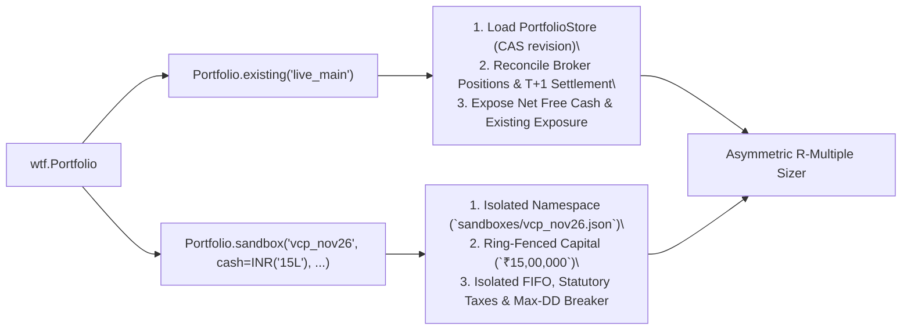

# High-Level Design (HLD): `honba.wtf` ("Work The Flow")

- **Document**: `01-HLD.md`
- **Part of**: [Honba WTF Design Suite](file:///home/pmallapp/Devel/Finance/honba-workspace/honba-tamashii/docs/wtf/00-INDEX.md)

---

## 1. Architectural Alignment & Honba Rule Compliance

`honba.wtf` extends the existing orchestration model established in [`honba/session.py`](file:///home/pmallapp/Devel/Finance/honba-workspace/honba-tamashii/python/honba/session.py): **Python owns the single unified CLI (`honba`), high-level workflow composition, and interactive debugging; Rust (`honba._honba`) owns every safety-critical, server, persistence, cryptographic, and compute-heavy primitive.**

| Workspace Rule ([README.md](file:///home/pmallapp/Devel/Finance/honba-workspace/README.md)) | Compliance in `honba.wtf` & Unified `honba` CLI |
|:---|:---|
| **Rule 1: Hard PyO3 Layer Boundary** | All PyO3 bindings live exclusively in `honba-tamashii/crates/honba-tamashii-py`. Zero `pyo3` dependencies enter `honba-kokoro`, `honba-mon`, `honba-te`, `honba-me`, `honba-nou`, or `honba-ya`. |
| **Single CLI & Acyclic Crate Graph (Option B)** | The legacy Rust `honba-ya-cli` binary crate is retired. `honba-ya` is a pure library workspace (zero `[[bin]]` targets, zero `clap` or `honba-tamashii*` dependencies), so `honba-tamashii-py` links `honba-ya-api-rest`, `honba-ya-persistence`, and `honba-ya-enhancer` cleanly in one direction (`honba-tamashii -> honba-ya`). Python `honba` (`honba.cli.main:app`) is the sole CLI entrypoint (`honba wtf`, `honba serve`, `honba migrate`, `honba backtest`, etc.). |
| **Rule 2: Pure Domain (`kokoro`)** | `honba-kokoro-portfolio` and `honba-kokoro-oms` remain pure and clock-free; `Flow` stamps UTC `as_of` and supplies marks/fills externally. |
| **Rule 3: First-Party vs. User Brokers** | First-party brokers (`Broker.zerodha`, `Broker.upstox`, `Broker.angelone`) dispatch into Rust `honba-te` + `honba-te-auth` via `_honba`. Experimental brokers can plug in a Python `honba.adapters.BrokerAdapter` without touching Rust. |
| **Rule 4: Indian Market Specifics** | Money/prices use `decimal.Decimal` (`INR`) on the Python side and `rust_decimal::Decimal` in Rust; Python `float` is rejected outright at the FFI gate. Every live order carries a SEBI `algo_id` and passes synchronously through `honba-mon::RiskEngine` (OTR + circuit bands). |
| **Rule 5: Typed Errors, Zero Panics** | Rust errors map to typed Python exceptions (`RiskGateRejectedError`, `BrokerAuthError`, `RevisionConflictError`, `OverfitRejectedError`) so workflows can catch, log, or pause cleanly. |

---

## 2. Plan 9 `acid` Mapped to the Honba Python SDK

Phil Winterbottom built `acid` around five structural ideas. Every one translates natively into Python + `honba-tamashii` without inventing a custom language:

| Plan 9 `acid` Mechanism | `honba.wtf` Python SDK Equivalent | Backing Implementation |
|:---|:---|:---|
| **Target Process (`pid` & `setproc`)** | **`wtf.Flow` Context (`with flow:` / `wtf.use(flow)`)**: Encapsulates bound `(Broker, Portfolio, algo_id)` | `honba.wtf.context.Flow` |
| **Architecture Layer (`mips`, `i386`)** | **Venue Abstraction (`Broker.zerodha`, `Broker.paper`, `Broker.sim`)**: Identical Python workflow runs against historical sim, live paper, or live broker | `honba-te-core::BrokerExecutor`, `honba.backtest.l2_sim` |
| **Live Memory Indirection (`*addr`)** | **`flow.live[...]`**: Dereferences live quotes, L2 depth, price bands (`flow.live["NSE:TCS"]`), MTM portfolio (`flow.live.pf`), and SEBI OTR (`flow.live.otr`) | `honba.client.Client` (`InprocTransport` / UDS / HTTP) + `honba-mon` |
| **File Image Indirection (`@addr`)** | **`flow.pit[...]`**: Point-in-time historical series (`flow.pit["NSE:TCS"]` $\rightarrow$ zero-copy Polars `DataFrame`) and `as_of` DuckDB fundamentals | `honba._honba.arrow` (PyArrow PyCapsule) + `honba-data` |
| **Format Codes (`\X`, `\i`) & `complex` Structs** | **Typed Value Wrappers (`INR`, `Pct`, `R`) + `wtf.show(obj, fmt=...)`**: Auto-formatted Rich/ASCII Trade Cards, deterministic JSON, or replayable Python expressions | `honba-tamashii-codegen` (Pydantic v2) + [`honba.display`](file:///home/pmallapp/Devel/Finance/honba-workspace/honba-tamashii/python/honba/display.py) |
| **Verification Libraries (`-l malloc`, `-l coverage`)** | **Playbook Library Modules (`from honba.wtf.lib import screen, detrap, sizing`)**: Composable Python functions backed by GIL-free Rust engines | `honba-nou-research`, `honba-ya-enhancer`, `honba.sizing` |
| **`stopped(pid)` Hook & `acid:` Prompt** | **`flow.confirm(value)` $\rightarrow$ `wtf>` Interactive Python Debugger**: Pauses workflow in-frame with live locals + concise helpers (`show`, `drop`, `cont`, `abort`) | Python `code.InteractiveConsole` / `IPython` |

---

## 3. System Architecture Diagram

```mermaid
flowchart TB
    subgraph UserFlows["User Playbooks & Unified CLI (Pure Python)"]
        CLI["`honba` CLI (`honba.cli.main:app`)\\nhonba wtf | honba serve | honba migrate | honba backtest"]
        Playbook["flows/swing_playbook.py\\n(Standard Python, IDE-typed, pytest-able)"]
        Repl["Interactive `wtf>` Breakpoint Console\\n(Inspect locals, Polars slicing, live ticks)"]
    end

    subgraph PySDK["honba-tamashii Python Surface (`honba.wtf`)"]
        FlowCtx["wtf.Flow Context\\n(Broker + Portfolio + algo_id)"]
        StdLib["honba.wtf.lib\\nscreen | devise | detrap | sizing | oms"]
        Display["honba.display & Pydantic Contracts\\n(Trade Cards, JSON, Lakhi/Crore INR)"]
    end

    subgraph PyO3Bridge["honba-tamashii-py (`honba._honba` PyO3 FFI)"]
        Bridge["GIL-Free Dispatch (`py.allow_threads`)\\nserver.rs (`serve_api`, `run_migrations`) & wtf_bridge.rs"]
    end

    subgraph RustCore["Pure Rust Engine Libraries (Zero Rust Binaries)"]
        Server["honba-ya-api-rest & honba-ya-persistence\\nAxum REST/WS Bootstrap & sqlx Migrations"]
        Auth["honba-te-auth\\nHeadless TOTP, OAuth, TokenCache, eDIS"]
        Risk["honba-mon\\nRiskEngine (SEBI AlgoId, OTR, Circuit Bands)"]
        Quant["honba-nou-research & honba-ya-enhancer\\nParityBacktestRunner, WFO, Monte Carlo, DSR/PBO"]
        Ledger["honba-kokoro-portfolio & PortfolioStore\\nExisting & Ring-Fenced Sandbox Ledgers"]
        Venue["honba-te & honba-me\\nLive BrokerExecutor / Feed OR L2 Sim"]
    end

    CLI --> Playbook
    CLI --> Bridge
    Playbook --> FlowCtx
    Playbook --> StdLib
    FlowCtx <--> Repl
    StdLib --> Display
    FlowCtx --> Bridge
    StdLib --> Bridge

    Bridge --> Server
    Bridge --> Auth
    Bridge --> Risk
    Bridge --> Quant
    Bridge --> Ledger
    Risk --> Venue
```

---

## 4. Flow Resource Binding: Broker & Portfolio Isolation

### 4.1 Broker Binding & Secret Safety

A `Flow` binds a broker declaratively without ever exposing raw credentials or bearer tokens to Python strings or logs:

1. **Encrypted / Keyring Secret Resolution**:
   - Supports both the existing Python [`FileSecretStore`](file:///home/pmallapp/Devel/Finance/honba-workspace/honba-tamashii/python/honba/adapters/secrets.py) (`0600` Fernet-encrypted store) and Rust `honba-te-auth` (`KeyringCredentialStore`, `EnvCredentialStore`).
   - Secret handles pass opaquely across `_honba` (`repr()` always redacts).
2. **Pre-Market Session & eDIS Automation**:
   - First-party brokers (`Broker.zerodha`, `Broker.upstox`, `Broker.angelone`) delegate login to `honba-te-auth::SessionManager` (RFC 6238 TOTP / OAuth + post-08:30 IST `TokenCache`).
   - Delivery sell workflows (`CNC`) automatically invoke `EdisPreAuthorizer` (`CdslGateway`) when `edis="on_sell"` is configured.
3. **Custom Python Broker Escape Hatch (Rule 3)**:
   - `Broker.custom(adapter_instance)` wraps any user-written `honba.adapters.BrokerAdapter`, routing its order intents through the exact same `honba-mon::RiskEngine` PyO3 gate before dispatch.

### 4.2 Portfolio Binding: `existing` vs. `sandbox`

Every workflow explicitly declares the portfolio ledger it operates against:



| Dimension | `Portfolio.existing(account_id)` | `Portfolio.sandbox(sandbox_id, cash, mode, max_dd)` |
|:---|:---|:---|
| **Modes** | `"live"` or `"paper"` | `"paper"` (default), `"backtest"`, or `"live_ringfenced"` |
| **Capital Basis** | Reconciled cash + collateral margin of the account | Strictly `allocated_cash + sandbox_realized_pnl - sandbox_open_exposure` |
| **Position Visibility** | Full account holdings (`CNC` T+1 + `MIS`) | **Only** lots tagged to `sbx:<sandbox_id>:*` |
| **Statutory Costs** | Broker fills + contract-note reconciliation | Exact `IndianStatutoryCostCalculator` (STT, stamp duty, exchange turnover, SEBI fee, GST) |
| **Drawdown Circuit** | Account-level `honba-mon` limits | Independent sandbox watermark (`max_dd`); auto-switches sandbox to reduce-only on breach without halting sibling portfolios |
| **Promotion** | N/A | `flow.promote_sandbox(target="live_ringfenced")` or CLI `--portfolio existing:live_main` |

---

## 5. Execution Modes

1. **Interactive Flow Execution (`honba wtf <flow>`)**:
   - Runs `<flow>.py` in a TTY. When `flow.confirm(shortlist)` is reached, prints the Trade Card (`honba.display`) and opens the `wtf>` interactive Python shell at that stack frame so the trader can inspect live market/portfolio state, filter `shortlist` with normal Python expressions, and call `cont()` or `abort()`.
2. **Exploratory Debugger (`honba wtf -i [<flow>]`)**:
   - Initializes the flow's `broker` and `portfolio` context without running the body, dropping immediately into `wtf>` for ad-hoc screening, Polars exploration of `flow.pit[...]`, or order inspection.
3. **Headless / Cron Batch Mode (`honba wtf --batch <flow>`)**:
   - Disables interactive prompts. `flow.confirm()` serializes the candidate `TradePlan` + SHA-256 `DatasetManifest` to the run journal and stages orders without live transmission unless `--auto-commit` is explicitly passed.
4. **Notebook / Library Import**:
   - Because a flow is standard Python, any researcher can `from flows.swing_playbook import flow` inside Jupyter or Marimo and step cells interactively.
